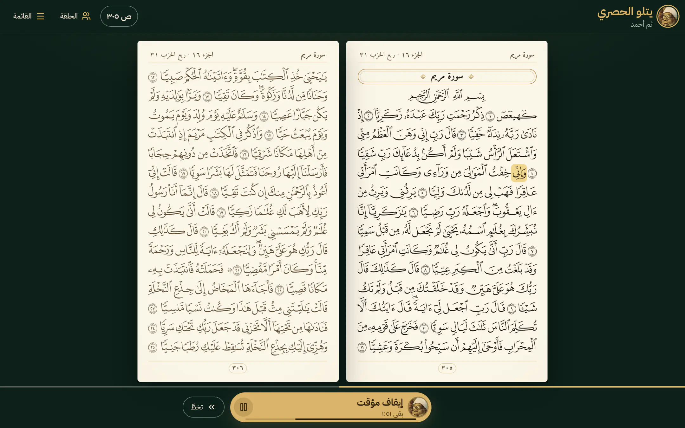
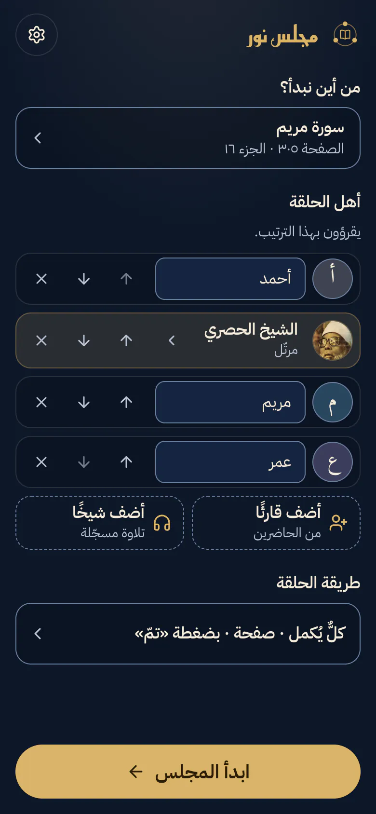
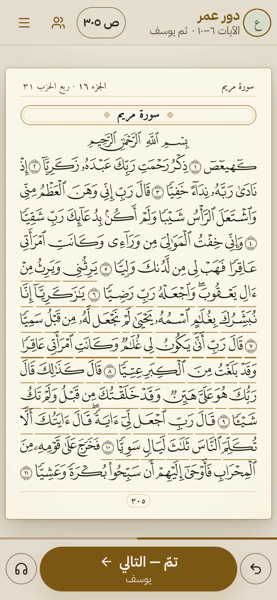
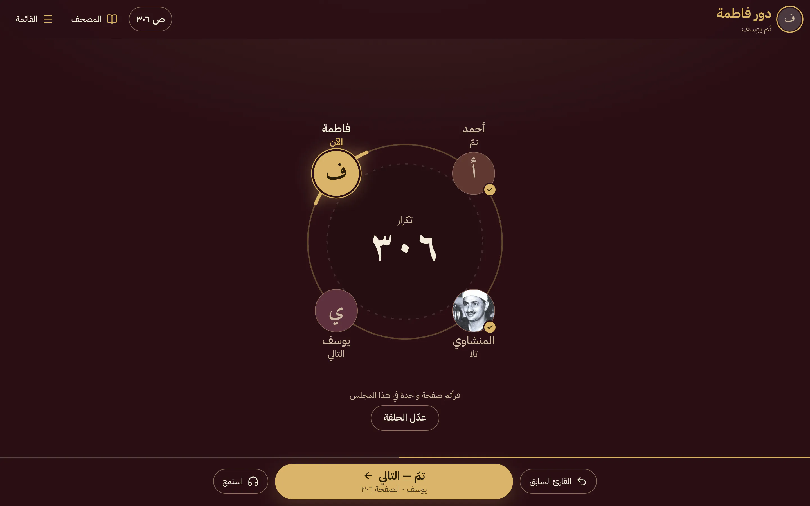

# مجلس نور

[افتح التطبيق](https://edriso.github.io/majlis-noor/)

مجلس نور حلقةُ قرآنٍ صغيرة على الشاشة، كما يجلس القرّاء في حلقة المسجد: يتناوبون القراءة في مصحف المدينة النبوية، صفحةً صفحة أو آياتٍ آيات؛ يقرأ الأول دوره، ثم الثاني، ثم الثالث، ثم يعود الدور إلى الأول. ويجلس معهم إن شاؤوا شيخٌ من كبار القرّاء: إذا جاء دوره تلا ما عليه بصوته، ثم انتقل الدور إلى من يليه.

افتح التطبيق، واختر حلقتك، واقرؤوا معًا. لا حساب ولا خادم، وكل شيء يبقى على جهازك.



<p>
  
  
</p>



## ما في مجلس نور

### المصحف

- **مصحف المدينة كما طُبع**: الصفحات الـ٦٠٤ لطبعة مجمع الملك فهد لطباعة المصحف الشريف برواية حفص، كل صفحة بخطّها الخاص وأسطرها الخمسة عشر، لا نصٌّ مُعاد التنسيق. اسم السورة والجزء والربع في أعلى الصفحة ورقمها في أسفلها، وعلامة السجدة حيث تكون، ويكبر ذلك كله مع حجم الخطّ في جهازك.
- **صفحتان متقابلتان على الشاشة العريضة**، كما يُفتح المصحف: الفردية على اليمين، وصفحة الدور بمداد كامل والأخرى بمداد أخفّ.
- **حجم الصفحة كما تحتاجون**: «الصفحة كاملة» بقدر الشاشة بلا تمرير، أو «بعرض الشاشة» أكبر وتُقرأ بالتمرير.
- **تقليب بالإصبع** بين صفحات الدور، يمينًا إلى الأمام كما يُقلَّب المصحف.
- **انسخ النصّ الحقيقي**: ما تحدّده من كلمات الصفحة يُنسخ بالرسم العثماني كما هو، لا رموزًا لا تُقرأ.

### أهل الحلقة

- **حتى ثمانية مقاعد، بالترتيب الذي تختارون**: أضيفوا القرّاء بأسمائهم (والأسماء اختيارية، والأول «أنت» إن لم يُكتب اسم)، وقدِّموا وأخِّروا من شئتم بزرّين بجانب كل اسم، فيدور الدور بهذا الترتيب. يبدأ المجلس بك وحدك، وما تختارونه يُحفظ على جهازك للمرة القادمة.
- **شيخ في الحلقة**: أضيفوا أحد القرّاء العشرة مقعدًا كأيّ واحد منكم، أو أكثر من شيخ. إذا جاء دوره تلا ما عليه بصوته، والصفحة تتقلّب مع تلاوته، ثم ينتقل الدور وحده إلى من بعده.
- **عشرة قرّاء، مجموعين بحسب أدائهم**: متأنٍّ جدًّا، ومتأنٍّ، ومعتدل، وسريع؛ وبجانب كلٍّ متوسط مدة صفحته، وزرّ تسمعه به يتلو الفاتحة قبل أن تختاره: الحصري (المعلّم والمرتّل)، وعبد الباسط، والعفاسي، والمنشاوي، والدوسري، والشاطري، والرفاعي، والسديس، والشريم.
- **صور المشايخ كما تحبون**: ظاهرة، أو مموّهة لا تُعرف بها الوجوه، أو مخفية فلا تُحمَّل أصلًا ويظهر مكانها الحرف الأول من الاسم.

### طريقة الحلقة

- **الدور بالصفحة أو بالآيات أو بربع الحزب أو بالسورة**: صفحة أو صفحتان أو ثلاث، أو آية أو آيتان أو ثلاث أو خمس أو عشر.
- **طريقتان للقراءة**:
  - **كلٌّ يُكمل**: يقرأ كل واحد ما بعد الذي قبله (الأول ٢٠، والثاني ٢١، والثالث ٢٢، ثم الأول ٢٣…).
  - **كلٌّ يكرّر**: يقرأ الجميع المقدار نفسه ثم ينتقلون إلى ما بعده، للتصحيح والحفظ والاستماع بعضهم لبعض.
- **حلقة تلقين بضغطة واحدة**: يتلو الحصري (المعلّم) ثلاث آيات، ثم يقرؤها الحاضرون بعده واحدًا واحدًا.
- **بدّل البادئ**: لمن يتبادلون الآيات، يبدأ كلَّ صفحة (أو سورة) قارئٌ غير الذي بدأ التي قبلها.
- **إلى أين؟** غايةٌ للمجلس إن شئتم: آخر السورة، أو آخر الجزء، أو صفحة بعينها. فإذا بلغتموها قيل «بلغتم الغاية»، ولكم أن تتابعوا أو تُنهوا المجلس.
- **الانتقال بضغطة «تمّ»، أو بتوقيت الشيخ**: يُقاس دور القارئ بمدة تلاوة شيخ مختار لما يقرؤه، فيظهر عدّاد هادئ وينتقل الدور حين ينتهي. ولأن الناس يقرؤون أبطأ من القارئ المتقن، تُمدّ «مهلة الدور» ربعًا أو نصفًا.
- **المراجعة من الحفظ**: تُغطّى الصفحة في دور القارئ، ويُكتب عليها من أين يبدأ، ويكشفها إن احتاج أن يتحقّق.

### في أثناء القراءة

- **شريط الدور في الأعلى**: من يقرأ الآن، بخطّ كبير وصورته في حلقة ذهبية، ومن بعده، وما يقرؤه إن لم يكن صفحة كاملة («الآيات ٥–٩»). ويُعلَّم على الصفحة ما يقرؤه صاحب الدور إن كان بعض صفحة.
- **زرّ واحد ينقل الدور**: «تمّ — التالي»، وتحته اسم من يليه وما يقرؤه، ومعه «القارئ السابق». وفي دور الشيخ يصير الزرّ نفسه إيقافًا للتلاوة واستئنافًا لها، وبجانبه «تخطَّ».
- **خطّ رفيع للتقدّم** فوق الأزرار: موضعكم في المصحف، أو ما بقي إلى الغاية.
- **الحلقة مرسومة، وهي ترتيب القراءة**: بزرّ في الأعلى تظهر الحلقة مكان الصفحة، أهلها حول دائرة بترتيبهم، ومن عليه الدور مضاء بالذهبي، وتحت كل مقعد حاله: «الآن»، أو «التالي»، أو «تمّ»، أو ما سيقرؤه. ومنها «عدّل الحلقة».
- **استمع إلى ما ستقرأ**: تلاوة ما عليك في الصفحة بصوت الشيخ المختار، قبل القراءة أو بعدها، مرةً أو مرتين أو ثلاثًا.
- **اضغط على آية لتسمعها**: تظهر الآية في شريط صغير فيه «استمع» مرة، و«كرّر ٣ مرات»، و«من هذه الكلمة» إن ضغطت على كلمة، و«انسخ الآية» بنصّها وموضعها، مثل «… ﴿١٤﴾ [النمل: ١٤]». وما كان يُتلى ينتظر حتى تنتهي الآية ثم يكمل من موضعه.
- **تتبّع الشيخ**: حين يتلو الشيخ تُعلَّم الآية التي يتلوها، أو الكلمة نفسها إن اخترتم «تتبّع الكلمة».
- **إيقاف واحد يوقف كل شيء**: إيقاف التوقيت يوقف معه التلاوة التي تُسمَع، والاستئناف يعيدهما معًا.
- **سرعة التلاوة**: متأنّية أو عادية أو أسرع، والصوت بنبرته لا يتغيّر.
- **نغمة خفيفة** إذا انتقل الدور وحده، بانتهاء التوقيت أو تلاوة الشيخ، ولها مفتاح يُسكتها.
- **الهاتف على جنبه**: يبقى شريط الدور وزرّ «تمّ» ظاهرين على جانبي الصفحة.
- **الصفحة وحدها**: «إخفاء الأزرار» يترك الصفحة وحدها بملء الشاشة، ويعيدها زرّ صغير في طرفها أو مفتاح Esc.
- **الختم**: إذا بلغ المجلس آخر المصحف قيل «خُتم المصحف»، وعُرضت ختمة جديدة من الفاتحة، مع طريق للرجوع إن كانت الضغطة خطأ.

### ختام المجلس

عند «إنهاء المجلس» تظهر بطاقة «ختام المجلس»: من أين قرأتم وإلى أين (السورة والآية والصفحة)، وكم صفحة وكم آية، ومدّة المجلس، ومن الساعة كم إلى كم، وتاريخ اليوم بالهجري والميلادي، ومن حضر، ثم دعاء كفّارة المجلس. وبـ«احفظ صورة» تُحفظ البطاقة صورةً على جهازك، أو تُرسل من قائمة المشاركة في الهاتف، في واحد من ثلاثة تصاميم: **مزخرفة** للمحادثات، و**حالة** طولية للحالة والقصص، و**بسيطة** مربّعة، ويتذكّر جهازك ما اخترت. تُصنع الصورة على جهازك ولا تُرسل إلى أحد، ولا حساب ولا تسجيل، ولا يحتفظ التطبيق بالملخّص بعد الإنهاء.

### على جهازك

- **يعمل دون اتصال**: من أول زيارة يُحفظ التطبيق وصفحات المصحف كلها على الجهاز. وخطّ كل صفحة يُحفظ متى فُتحت، وإن لم يتيسّر عُرضت الصفحة بخطّ بديل كامل الحروف. أما التلاوات فتحتاج اتصالًا.
- **تُحفظ الحلقة على جهازك وحده**: إن أُعيد تحميل الصفحة عُرض عليكم أن تتابعوا المجلس من موضعه ومع صاحب الدور نفسه، وإذا أنهيتم المجلس بدأ الذي بعده من حيث وقفتم.
- **أربعة ألوان**: أخضر وعنّابي وأزرق كسجّاد المسجد ليلًا، ورملي فاتح للنهار والغرف المضيئة. وفي أول زيارة يتبع التطبيق نظام جهازك فاتحًا أو داكنًا.
- **يبقى الهاتف مضاءً** ما دام المجلس مفتوحًا، وتظهر تلاوة الشيخ على شاشة القفل، وتتحكّم بها أزرار السمّاعة.

## لوحة المفاتيح

| المفتاح | ما يفعله                                                         |
| ------- | ---------------------------------------------------------------- |
| `←`     | تمّ، القارئ التالي (أو الصفحة التالية في الدور)، أو تخطَّ الشيخ |
| `→`     | رجوع إلى الصفحة أو القارئ السابق                                 |
| `مسافة` | إيقاف الآية أو تلاوة الشيخ أو التوقيت أو الاستماع مؤقتًا، واستئنافها |
| `Esc`   | إظهار الأزرار بعد إخفائها، وإغلاق شريط الآية                      |

الأسهم تقلب الصفحة كما يُقلب الكتاب العربي: اليسار إلى الأمام. وعلامة آخر كل آية زرٌّ يُبلغ بلوحة المفاتيح.

## سهولة الوصول

الواجهة عربية من اليمين إلى اليسار، وكل زرّ له اسم يقرؤه قارئ الشاشة يبدأ بما يُرى عليه، ولا يقلّ زرّ عن ٤٤ بكسل (إلا علامات الآيات داخل الأسطر)، وتباين النصوص يوافق WCAG AA في الألوان الأربعة، والزرّ المعطّل يبقى مقروءًا. وتحت كل سطر من خطّ المصحف نصّه العثماني مقروءًا لقارئ الشاشة، ويُعلَن انتقال الدور مرة واحدة حين يقع، ويُعلَن كل تقديم أو تأخير أو إضافة في أهل الحلقة، وينتقل التركيز إلى عنوان الشاشة الجديدة ويعود من كل نافذة إلى ما فتحها. ومن طلب تقليل الحركة في نظامه سكنت له الحركة، ومن استعمل الألوان العالية التباين بقيت له العلامات ظاهرة.

## المصادر

- **صفحات المصحف**: تخطيط الأسطر ورموز الخطوط ونصّ الكلمات من [Quran.com](https://quran.com)، وخطوط الصفحات من مجمع الملك فهد لطباعة المصحف الشريف تُحمَّل عند القراءة.
- **التلاوات وتوقيت آياتها وكلماتها**: من [QuranicAudio](https://quranicaudio.com) وواجهة Quran.com، وكلاهما من مشاريع Quran Foundation.
- **خطوط الواجهة**: IBM Plex Sans Arabic وReem Kufi وAmiri وAmiri Quran، بترخيص SIL Open Font License، محفوظة مع التطبيق.
- **صور القرّاء**: من ويكيميديا كومنز، ولكلّ صورة مصدرها وترخيصها في [NOTICE](NOTICE).

## شكر وتقدير

بدأ مجلس نور في [مجتمع إتقان](https://community.itqan.dev/d/839)، ومن اقتراحات أهله جاء أكثر ما في [خطّة العمل](docs/ROADMAP.md). جزى الله خيرًا:

- **يوسف حجازي**: أصل الفكرة، في [منشور «برنامج السبع»](https://community.itqan.dev/d/817) عن حلقة المراجعة المعروفة عند أهل الصومال، يتناوب فيها أهلها القراءة حتى يختموا القرآن، ومعهم كبار القرّاء.
- **علي ملص**: تمييز الكلمة أو الجملة المقروءة بتزمين التلاوة، والدور بالآية أو السورة أو الجملة لا بالصفحة وحدها، وأكثر من أربعة مقاعد، والحلقة عن بُعد، والدلالة على [منجم](https://community.itqan.dev/d/812) لتزمين التلاوات.
- **خالد بن أحمد**: تقسيم الدور بعدد الآيات أو بالمقاطع الموضوعية.
- **دينا أحمد**: النظر إلى الحلقة من مقام التعليم: يتلو الشيخ ثم يقرأ الحاضرون بعده تلقينًا، والوقوف عند موضعٍ بعينه وإعادته، والدور بالآيات أو بالأرباع لمن يبدأ.
- **علا صالح**: الدور بعدد من الآيات، وتبادل الآيات بين قارئَين مع تبديل البادئ في كل صفحة أو سورة، وتحديد بداية المجلس ونهايته، وملخّصٌ في ختامه: من أين إلى أين، وعدد الصفحات أو الآيات، ومدّة المجلس، ومن حضر، يُحفظ على الجهاز بلا حساب.
- **هادي الأحمد**: الاتصال المباشر بين الأجهزة (WebRTC) لقراءةٍ جماعية بلا خوادم مدفوعة، وتجربة [SyncQuran](https://github.com/hadealahmad/SyncQuran) فيه.
- **أبو بكر عبد الرحمن**: تجربة الصفحات ومراجعتها، كالصفحة ٢٩٣ التي تبدأ في وسطها سورة الكهف.

## ما القادم

أُنجز أكثر ما في [خطّة العمل](docs/ROADMAP.md)، وبقي منها:

- **سياسة أمان للمحتوى**، تقصر ما يحمّله التطبيق على مصدره وعلى مصدرَي التلاوات وخطوط الصفحات.
- **خطوط الصفحات من التطبيق نفسه**، إن أذنت بذلك Quran Foundation.
- **صور جديدة** للتطبيق في هذه الصفحة.

وما لم يدخل في هذه المرحلة، كالقراءة معًا من أجهزة متعددة والدور بالجملة أو بالموضوع، مكتوبٌ في الخطّة مع سببه.

## للمطوّرين

```sh
npm install
npm run dev        # خادم محلي
npm test           # الاختبارات
npm run lint       # oxlint
npm run build      # فحص الأنواع ثم البناء
```

اقرأ [AGENTS.md](AGENTS.md) قبل أي تعديل، ثم [docs/CONTRIBUTING.md](docs/CONTRIBUTING.md) لأول تغيير. ويُنشر التطبيق على GitHub Pages تلقائيًا عند كل دفع إلى `main`.

## الترخيص

كل ما كُتب لهذا المستودع تحت [0BSD](LICENSE): خذه واستعمله بلا شرط. وما يُعاد توزيعه من غيرنا (بيانات المصحف والتوقيتات، والخطوط، والأيقونات، وصور القرّاء) له شروطه في [NOTICE](NOTICE).
